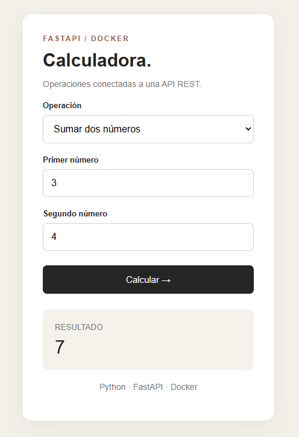
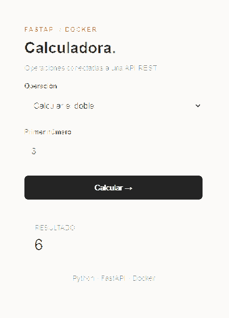
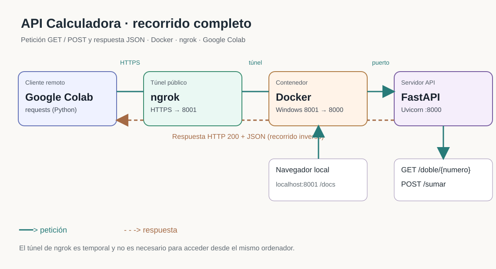

# API Calculadora · FastAPI + Docker

[](https://github.com/raineragoge/api-calculadora-fastapi/actions/workflows/ci.yml)

Aplicación web educativa de una calculadora construida con **FastAPI (Python)**, **HTML, CSS y JavaScript**, y ejecutada dentro de un contenedor **Docker**. También se ha probado el acceso remoto mediante **ngrok** y el consumo de la API desde **Google Colab**.



<details>
<summary>Ver también el cálculo del doble</summary>



</details>

## ¿Qué hace?

- Calcula el doble de un entero mediante una petición **GET**.
- Suma dos números mediante una petición **POST** que envía un cuerpo JSON.
- Presenta una interfaz web responsive que utiliza `fetch()` para comunicarse con la API.
- Expone documentación interactiva con Swagger UI en `/docs`.

## Arquitectura

```text
Navegador / Google Colab
          |
       HTTP(S)
          |
     [ngrok]  (opcional para acceder desde Internet)
          |
 localhost:8001
          |
     Contenedor Docker
          |
     Uvicorn :8000
          |
       FastAPI
        /   \
GET /doble   POST /sumar
```

El HTML se sirve desde FastAPI en la ruta `/`, por lo que el frontend y la API comparten origen y no requieren configurar CORS para este ejemplo.

## Requisitos

- **Docker Desktop**, con el motor en ejecución, para la opción recomendada.
- Alternativamente, **Python 3.12+** para ejecutarla directamente sin Docker.

## Ejecutar con Docker (recomendado)

Desde la carpeta del proyecto:

```bash
docker build -t api-calculadora .
docker run --rm --name calculadora-api -p 8001:8000 api-calculadora
```

Abre:

- Interfaz gráfica: http://localhost:8001/
- Documentación Swagger: http://localhost:8001/docs
- Ejemplo GET: http://localhost:8001/doble/9

Para detener el contenedor, pulsa **Ctrl+C** en la terminal. Si el nombre ya está ocupado por un contenedor anterior, puedes detenerlo y eliminarlo con `docker rm -f calculadora-api` y volver a ejecutar `docker run`.

## Ejecutar sin Docker

En Windows (PowerShell):

```powershell
python -m venv .venv
.\.venv\Scripts\Activate.ps1
python -m pip install -r requirements.txt
python -m uvicorn main:app --reload
```

Abre http://127.0.0.1:8000/ y http://127.0.0.1:8000/docs.

## Endpoints

| Método | Ruta | Entrada | Respuesta de ejemplo |
| --- | --- | --- | --- |
| GET | `/` | Ninguna | Página HTML |
| GET | `/doble/{numero}` | Número entero en la ruta | `{"numero": 9, "doble": 18}` |
| POST | `/sumar` | JSON `{"a": 3, "b": 4}` | `{"resultado": 7.0}` |

**Ejemplo GET** (desde una terminal):

```bash
curl http://localhost:8001/doble/9
```

**Ejemplo POST** (desde PowerShell):

```powershell
Invoke-RestMethod -Uri http://localhost:8001/sumar -Method Post -ContentType 'application/json' -Body '{"a":3,"b":4}'
```

## Pruebas automatizadas

Instala las dependencias de desarrollo y ejecuta las pruebas desde la raíz del proyecto:

```bash
python -m pip install -r requirements-dev.txt
python -m pytest -q
```

Las pruebas comprueban las operaciones GET/POST, las validaciones HTTP 422, la respuesta HTML de la interfaz y la generación de OpenAPI. El flujo de **GitHub Actions** (`.github/workflows/ci.yml`) ejecuta los tests y construye la imagen Docker en cada `push` a `main` y en cada pull request.

### Consumir desde Google Colab

Primero, con Docker en ejecución, crea un túnel local:

```bash
ngrok http 8001
```

Copia la URL HTTPS generada por ngrok y úsala en Colab:

```python
import requests

BASE_URL = "https://TU-DOMINIO.ngrok-free.dev"  # Sustituye por tu URL actual
headers = {"ngrok-skip-browser-warning": "true"}

get_response = requests.get(f"{BASE_URL}/doble/12", headers=headers, timeout=15)
get_response.raise_for_status()
print(get_response.json())  # {'numero': 12, 'doble': 24}

post_response = requests.post(
    f"{BASE_URL}/sumar",
    json={"a": 35, "b": 65},
    headers=headers,
    timeout=15,
)
post_response.raise_for_status()
print(post_response.json())  # {'resultado': 100.0}
```

> **Seguridad:** el túnel ngrok expone estos endpoints a Internet mientras esté activo. Este proyecto es una demostración sin autenticación: no lo utilices para procesar datos privados ni expongas tokens de ngrok en el repositorio. Detén el túnel cuando acabes.

## Estructura del proyecto

```text
api-calculadora-fastapi/
├── assets/
│   ├── calculadora-doble.png
│   └── calculadora-sumar.png
├── Cliente_API_Calculadora.ipynb
├── docs/
│   ├── diagrama-arquitectura.md
│   ├── diagrama-arquitectura.svg
│   └── evidencias.md
├── .github/workflows/ci.yml
├── tests/test_api.py
├── requirements-dev.txt
├── .dockerignore
├── .gitignore
├── Dockerfile
├── README.md
├── index.html
├── main.py
└── requirements.txt
```

## Evidencias de evaluación (rúbrica oficial)

| Criterio | Evidencia que puede comprobar el profesor |
| --- | --- |
| Repositorio (2 puntos) | Código, Dockerfile, dependencias, instrucciones y pruebas presentes en GitHub |
| API y comprobación (6 puntos) | GET y POST en `main.py`, Swagger `/docs`, [salidas verificadas](docs/evidencias.md) y [notebook de Colab con respuestas visibles](Cliente_API_Calculadora.ipynb) |
| Diagrama (2 puntos) | [Diagrama completo de petición y respuesta](docs/diagrama-arquitectura.md) |



> La URL de ngrok del notebook corresponde a la sesión de prácticas y puede dejar de funcionar. Las salidas obtenidas están guardadas en el propio `.ipynb`. No se incluyen tokens de autenticación.

## Qué se ha aprendido

1. Crear endpoints **GET** y **POST** en FastAPI.
2. Validar cuerpos JSON con **Pydantic**.
3. Probar la API con Swagger/OpenAPI.
4. Contenerizar una aplicación Python con Docker.
5. Exponer temporalmente un servidor local con ngrok.
6. Consumir una API con `requests` desde Colab.
7. Conectar una interfaz HTML/JavaScript a un backend mediante `fetch()`.
8. Automatizar pruebas y la verificación de una imagen Docker con GitHub Actions.

**Alcance:** proyecto didáctico. No incluye autenticación, persistencia de datos ni despliegue permanente. Sí incluye CI (pruebas y comprobación de construcción), pero no CD (despliegue automático).

## Conclusión

Me ha ayudado a enterlo el tratar de pensar que las APIs son como funciones de Python o C++.
Es decir, yo creo una función (una API) y luego puedo llamar a esa función cuando quiera hacer la acción que encierra esa función (el usuario usa el token para hacer una solicitud a la API)
Además, como en las funciones, podemos meter información dentro de la API con Post, que es similar a lo que tambien se pueden hacer en las funciones.
En definitiva, lo veo algo sumamente util y que además puede ser la base de muchos negocios.  

Gracias por leer has el final

                                                                                                                                           
