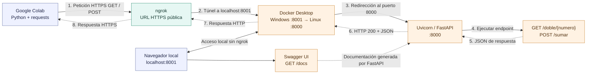

# Diagrama de arquitectura y flujo de la API

El cliente remoto (Google Colab) realiza peticiones HTTP/HTTPS al dominio temporal de ngrok. El túnel redirige la petición al puerto **8001** del equipo Windows; Docker publica ese puerto hacia el **8000** del contenedor Linux, donde Uvicorn sirve la aplicación FastAPI. FastAPI ejecuta el endpoint y devuelve JSON por el mismo camino, en sentido contrario.

**Convenciones:** líneas continuas = envío/uso de la API; líneas discontinuas = recorrido de la respuesta JSON.

## Pruebas de esta entrega

- `GET /doble/12`: HTTP `200` → `{"numero": 12, "doble": 24}`.
- `POST /sumar` con `{"a": 35, "b": 65}`: HTTP `200` → `{"resultado": 100.0}`.
- Ambas respuestas están guardadas en [Cliente_API_Calculadora.ipynb](../Cliente_API_Calculadora.ipynb).
